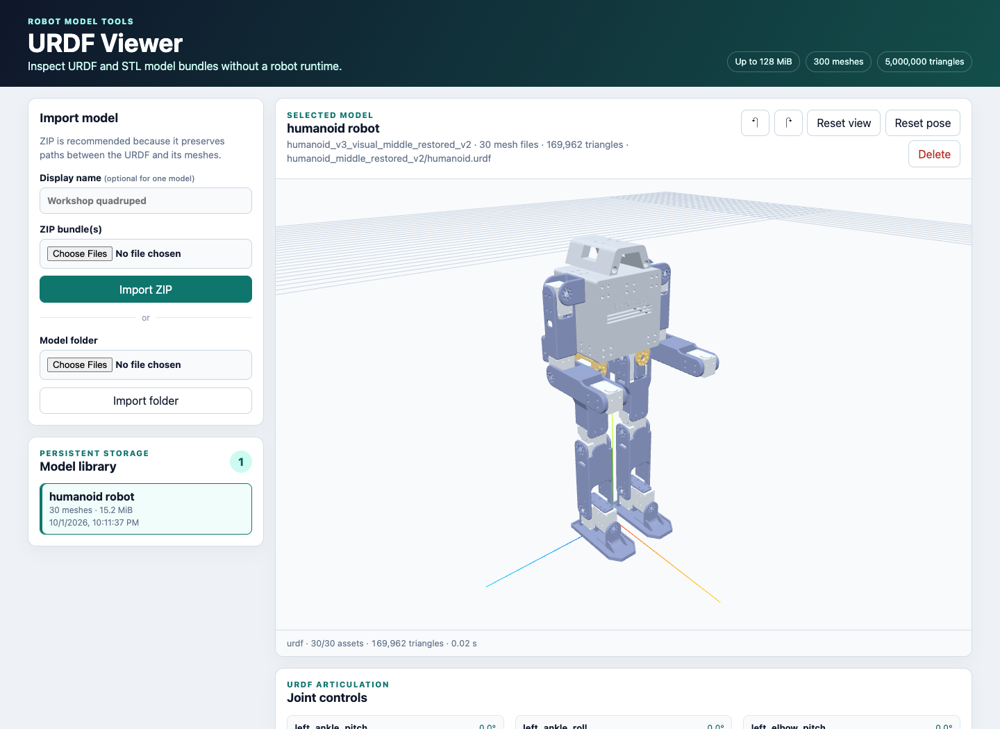

# URDF Viewer

A standalone browser-based library for importing, validating, storing, and inspecting URDF models with STL visual
meshes. It includes an interactive Three.js viewport, generated controls for movable joints, persistent local storage,
and strict validation for untrusted model bundles. It does not load robot configuration or connect to robot hardware.



## Features

- Import one or more ZIP bundles, or select a model directory in supported browsers.
- Preserve a local library across restarts using portable JSON manifests and source files.
- Orbit, pan, zoom, reset the camera, and inspect movable joints with generated sliders.
- Validate paths, XML, referenced assets, archive expansion, STL sizes, and triangle counts before publishing a model.
- Run directly with Java/Maven or as a non-root Docker container.

## Quick Start with Docker

Run the public `renarj/urdf-viewer:edge` image with Docker installed and running. No local Java, Maven, or source checkout
is required:

```bash
docker run --rm --pull always \
  --name urdf-viewer \
  -p 127.0.0.1:8081:8081 \
  -v urdf-viewer-data:/data/urdf-viewer \
  renarj/urdf-viewer:edge
```

Open [http://localhost:8081](http://localhost:8081) in a WebGL-capable browser and import your model ZIP or directory.
The browser needs internet access for the viewer's pinned dependencies. Press `Ctrl+C` to stop the container; imported
models remain in the `urdf-viewer-data` volume and are available the next time you run the command.

The `edge` tag tracks the latest development build from `main`; `--pull always` fetches the current image on each start.

## Requirements to build

- Java 21 (when running outside Docker)
- Maven 3.9 or newer (when building or running from source)
- A WebGL-capable browser with internet access for the pinned Three.js and `urdf-loader` CDN modules

## Run

From the project root:

```bash
mvn spring-boot:run
```

Open `http://localhost:8081`. Model data is stored below `./data/urdf-viewer` by default. Override it with:

```bash
mvn spring-boot:run \
  -Dspring-boot.run.arguments=--urdf.viewer.storage-dir=/absolute/model/library
```

Build and run the executable JAR:

```bash
mvn clean package
java -jar target/urdf-viewer-1.0.0-SNAPSHOT.jar
```

## Docker Local Build

Build the image and persist the model library in a named volume:

```bash
docker build -t urdf-viewer .
docker run --rm \
  --name urdf-viewer \
  -p 8081:8081 \
  -v urdf-viewer-data:/data/urdf-viewer \
  urdf-viewer
```

Open `http://localhost:8081`. To bind-mount a host directory instead, ensure UID/GID `10001` can write it or supply a
compatible `--user` value.

## Import Contract

ZIP is the preferred format. Each archive must contain a primary expanded `.urdf` file and every STL referenced by
its `<visual>` elements, preserving relative paths. An archive may also contain a clearly named auxiliary URDF such as
`*_reference.urdf`; `robot.urdf`, `model.urdf`, and `main.urdf` are recognized as explicit primary names. Multiple ZIPs
can be imported in one operation. Folder upload is also available in browsers that preserve directory-relative filenames.

Unrelated bundle artifacts such as preview images, source archives, and model-generation scripts are ignored rather than
making an otherwise valid visual model fail to import. They are not published through the model asset API.

Imports are staged and become visible only after validation. The importer rejects unsafe paths, symbolic links,
external XML entities, remote assets, missing meshes, unsupported mesh formats, and configured resource-limit
violations. Stored models use generated IDs and a `manifest.json`; the library is reconstructed from those manifests
after restart.

The default safety envelope accepts up to 128 MiB compressed upload data, 256 MiB of extracted model files, 256 MiB
of unique STL data, 300 visual mesh references, and 5,000,000 triangles. These remain configurable through the
`urdf.viewer.*` properties. ZIP path, per-file, file-count, and XML safety checks remain active independently of these
larger whole-model limits.

`package://` mesh references are accepted when the package directory can be resolved inside the uploaded bundle. Xacro,
DAE, OBJ, glTF, remote URLs, and collision rendering are not supported in the initial version.

## Viewer

The browser uses the generic URDF/STL loader originally extracted from Robot Studio. It waits for all meshes before
displaying a model, fits the camera to model bounds, supports orbit/pan/zoom, and exposes sliders for movable URDF joints.
On load, the model keeps its URDF orientation with Z-up converted to the viewer's Y-up, and is shifted vertically so its
lowest visual point rests on the floor grid. This placement stays fixed while articulating joints.
Three.js and `urdf-loader` use a pinned CDN import map, so page use currently requires access to those dependencies.

## Configuration

Spring Boot environment variables can override all settings. Common examples:

| Environment variable | Default | Purpose |
| --- | --- | --- |
| `SERVER_PORT` | `8081` | HTTP port. |
| `URDF_VIEWER_STORAGE_DIR` | `./data/urdf-viewer` | Persistent model-library location. |
| `URDF_VIEWER_MAX_UPLOAD_BYTES` | `134217728` | Maximum compressed bytes per uploaded bundle. |
| `URDF_VIEWER_MAX_EXTRACTED_BYTES` | `268435456` | Maximum total extracted bytes. |
| `URDF_VIEWER_MAX_TRIANGLES` | `5000000` | Maximum total STL triangle count. |

See `src/main/resources/application.properties` for every limit.

## Contributing

Start with [the development guide](docs/development.md) and [architecture notes](docs/architecture.md). Automated tests
cover valid imports, storage behavior, package references, malformed archives, unsafe XML, missing meshes, and resource
limits. Contributions that change import behavior should include regression tests.

This application currently has no authentication. Keep it on a trusted network or put it behind an authenticated reverse
proxy before making it publicly reachable.

## License

Copyright 2026 Renze de Vries. This project is source-available under the
[PolyForm Noncommercial License 1.0.0](LICENSE). It permits noncommercial reuse, modification, and redistribution,
including the additional organizational uses specified in the license. Commercial uses outside those permissions require
a separate written agreement with Renze de Vries; contact the maintainer through the
[GitHub repository](https://github.com/renarj/urdf-viewer).

Redistributions must include the license terms (or their URL) and preserve the `Required Notice:` lines in [NOTICE](NOTICE).
The attribution does not have to appear in the viewer itself. The viewer footer displays the publishing year and author,
and links to the bundled license and attribution notice.

Previously published versions and code released under Apache 2.0 retain those permissions. This license change does not
revoke earlier Apache grants. Third-party dependencies retain their respective licenses.
